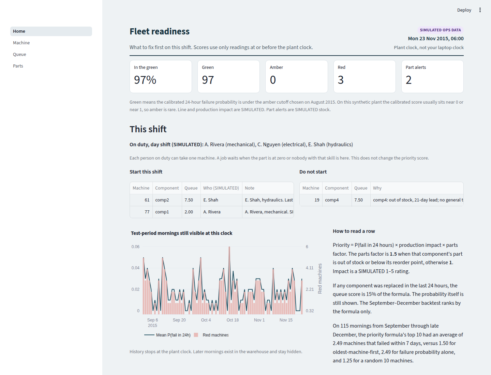
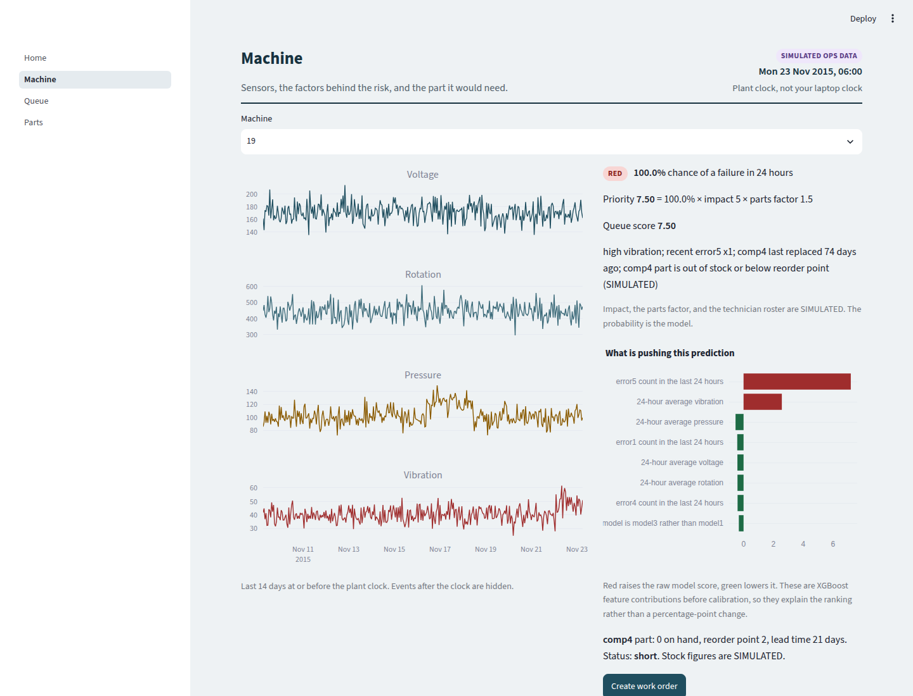
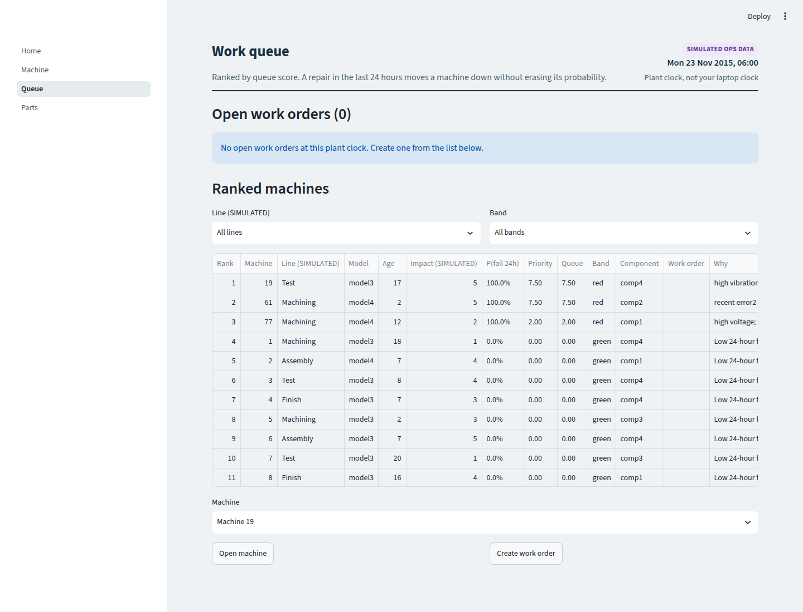
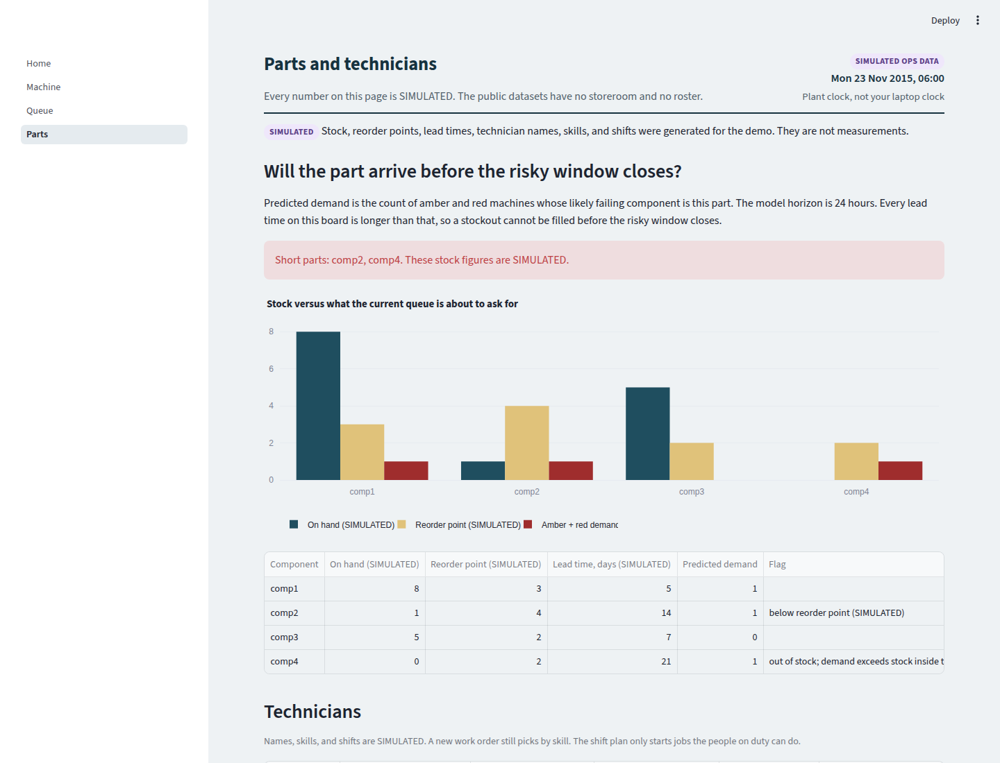
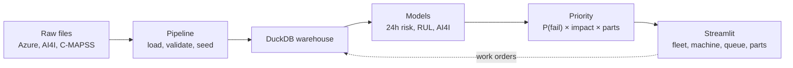
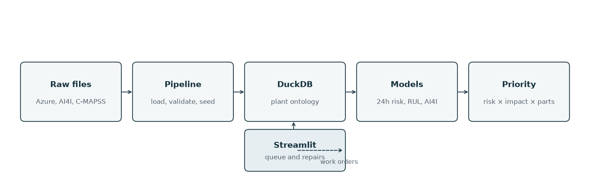
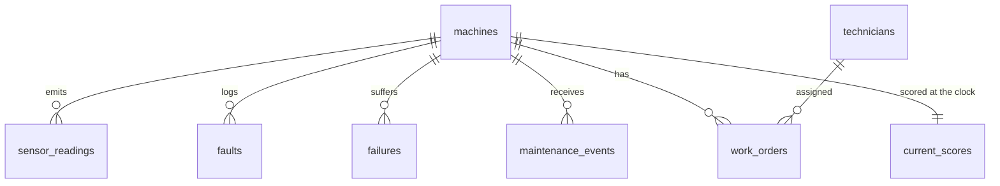

# Forged Machine Monitoring

I built Forged for the maintenance lead at a small or mid-size US manufacturer, especially a defense supplier, who starts the shift with more machines than people.

Unplanned downtime is how those shops lose readiness. A certified process or a single constraint machine stops, the order slips, and the crew spends the morning on whichever machine is already down, or on whichever one is oldest. The part they need is often not on the shelf. The failure is rarely a mystery after the fact. Before the fact it is a ranking problem, and most shops this size do not have a reliability engineer on the payroll.

Forged is a machine-readiness desk for that morning. It ranks machines by the chance of a failure in the next 24 hours, times how much production that machine stops, times whether the part is on the shelf. The screen is for the person who assigns the next technician. The models are scikit-learn and XGBoost. Nothing in the scoring path calls a language model.

## What the data actually shows

Two results are the ones I would rather be asked about. Both are copied from [results/results.md](results/results.md). If you retrain, that file wins.

**Remaining life, NASA C-MAPSS FD001.** On the official test file, XGBoost RMSE is **19.47** cycles. A linear regression on the raw sensors, the baseline, is **21.90**. The lift is real and modest. This is a turbofan simulator, not a factory floor. Error is larger when the engine still has a long life (23.4 RMSE past 125 cycles, versus 17.1 when fewer than 30 cycles remain).

**Maintenance priority, backtest.** On 115 mornings in the test window, the priority list's top 10 machines averaged **2.49** failures within 7 days. Oldest-machine-first averaged **1.50**. A random 10 averaged **1.25**. Ranking by probability alone also scored 2.49 on this file, because the calibrated probability sits near 0 or near 1. The business weights change the order among machines that are already red.

At the planning rates in [cost_assumptions.py](cost_assumptions.py), that gap is about **$546,638** over those 115 mornings versus oldest-first, and about **$685,474** versus random. One extra catch on the reference machine (impact 3, comp2, part in stock) is **$4,838**. These are not invoices. The arithmetic is in the cost section of [results/results.md](results/results.md) and on the dashboard.

**The Azure predictive-maintenance file is simulated.** It is a Microsoft tutorial dataset, not a factory. The 24-hour XGBoost model on that file has an F1 of **0.993**. That is not a real-factory result, and I do not want it quoted as one. The logistic regression on the same split (F1 0.821) is the floor that shows the signal is simple. AI4I, a separate rare-event set, is the corrective: XGBoost F1 **0.608**.

The plant on the dashboard, once you run `make pipeline` and `make train`, is that Azure sample: 100 machines, hourly sensors for 2015. Parts, technicians, production lines, and production impact are **simulated** and labeled that way on every screen. NASA C-MAPSS and AI4I are separate modeling exercises. They are not the machines on the fleet page. If you open the app with no warehouse, it builds a 12-machine sample so the screens work. That sample is authored scores, not the model, and the page says so.

## Live demo

The app is deployed: [forged.streamlit.app](https://forged.streamlit.app/).

That URL opens the 12-machine sample. Machine 4 is the worked example (priority 7.50). The published RMSE, the 2.49 backtest, and the dollar figures are from `results/` on the full files, and the page says so. How it was deployed is under [Deploy](#deploy).

- Loom walkthrough: `https://www.loom.com/share/<recording-id>` — not recorded yet. Record a five-minute pass of the fleet, one machine, the queue, and the parts page, then replace this link.

## Who it is for

A maintenance manager or plant manager at a shop of about 20 to 500 people, including defense suppliers who cannot staff every machine every morning. The user of the screen is the person who assigns the next technician. The user of the repository is someone who needs to defend the data model, the split, and the metrics.

## Fleet, on the demo morning

Monday 23 November 2015, 06:00. Three machines are red. Ninety-seven are green. The top of the ranked list is machine 19: high vibration, a recent error5, comp4 last replaced 74 days ago, and the simulated comp4 part is out of stock. Priority is 7.50, which is `1.00 × impact 5 × parts factor 1.5`.

The shift plan then says not to start that job. It is 06:00, the day shift. The only general technician is on swing, and comp4 is at zero on the shelf with a 21-day lead time. The jobs that can start are machine 61 with E. Shah (hydraulics, one part left) and machine 77 with A. Rivera (mechanical). The roster and the stock are simulated. The priority score itself is unchanged.

Those screenshots are the full Azure warehouse after `make train`. The bundled sample, which is what Streamlit Cloud and Docker open, uses the same arithmetic on 12 machines. Machine 4 is probability 1, impact 5, comp4 out of stock, priority 7.50. It is not machine 19, and the page says so.









A rehearsal script is in [docs/DEMO_SCRIPT.md](docs/DEMO_SCRIPT.md).

## Run it

Python 3.12. From a fresh clone:

```bash
python3 -m venv .venv
source .venv/bin/activate
pip install -r requirements-dev.txt
make download
make pipeline
make train
make test
make dashboard
```

The dashboard listens on port **8741** ([http://127.0.0.1:8741](http://127.0.0.1:8741)).

| Command | What it does |
| --- | --- |
| `make download` | Fetches the three datasets into `data/raw/`. Skips files that are already there. `FORCE=1` downloads again. |
| `make pipeline` | Rebuilds `data/warehouse.duckdb` from the raw files, validates them, and seeds the simulated roster. |
| `make train` | Trains all three models, writes `results/results.md`, and scores every test-period morning. |
| `make test` | Runs pytest. Does not need the raw files. |
| `make lint` | Ruff. The same check CI runs. Needs `requirements-dev.txt`. |
| `make dashboard` | Streamlit. If no warehouse exists yet, the app builds the 12-machine sample. |
| `python -m pipeline.replay --as-of "2015-11-23 06:00"` | Moves the plant clock and rescores. |
| `python -m pipeline.replay --advance-hours 24` | Moves the clock forward one day. |

`make check` is the import smoke test: `import xgboost, streamlit`.

## Deploy

The public app is [forged.streamlit.app](https://forged.streamlit.app/). Two ways to run it yourself:

**Streamlit Community Cloud.** The deployed app was created at [share.streamlit.io](https://share.streamlit.io/) with:

| Setting | Value |
| --- | --- |
| Main file | `app/Home.py` |
| Requirements | `requirements.txt` |
| Python | 3.12 (`runtime.txt` and `.python-version`) |

No secrets. The first page load builds a 12-machine sample warehouse in the app's filesystem, so the deploy does not download Azure, NASA, or AI4I and does not need the trained-model rescore path. The published RMSE, the 2.49 backtest, and the dollar figures still come from `results/`, and the banner says the 12 machines are not that run.

**Docker.** From the repo root:

```bash
docker build -t forged .
docker run --rm -p 8741:8741 forged
```

Open [http://127.0.0.1:8741](http://127.0.0.1:8741). Same sample plant on first start. The image does not contain `data/raw/`.

A Loom walkthrough is still a manual recording. The link at the top of this file stays a placeholder until that recording exists.

Training the remaining-life grid search takes a few minutes. The Azure feature table is about two seconds. Expect the full `make train` to take roughly five to eight minutes on a 4-core machine.

## Architecture





The warehouse holds the whole year. The **plant clock** is what the dashboard treats as now. Views hide rows after the clock, and the queue is rescored from readings up to that hour. That is the replay. It is not 8,761 separate inserts. Details and the column-by-column mapping are in [docs/schema.md](docs/schema.md). The picture of the tables is [docs/schema.png](docs/schema.png).



## Models

Full write-up, confusion matrix, and the error-by-life split: [results/results.md](results/results.md). Regenerated by `make train`.

### Will it fail in 24 hours? (this is the dashboard model)

Azure sample. Fit on January–July 2015. August is used only to calibrate probabilities and to pick the threshold. Test is 1 September through 30 December 06:00. About 1.8% of test hours are positive. A model that never predicts a failure is 98.2% accurate and has an F1 of 0.

| Model | Precision | Recall | F1 | PR-AUC |
| --- | ---: | ---: | ---: | ---: |
| Logistic regression | 0.799 | 0.845 | 0.821 | 0.836 |
| XGBoost | 0.994 | 0.992 | 0.993 | 0.988 |

Mean calibrated probability on the test hours is 0.018, the same as the failure rate. The scores themselves pile up near 0 and near 1, because this simulator leaves a loud fingerprint. **Do not quote 0.99 as what a real factory will get.** The logistic number is the honest floor. XGBoost's confusion matrix is 5,274 true positives, 33 false positives, 40 false negatives.

### Remaining useful life, NASA C-MAPSS FD001

100 engines, labels capped at 125 cycles. Engines are never on both sides of a split. The saved model is the better GroupKFold result, not the better test score. Tested once on the official file.

| Model | Features | CV RMSE | RMSE vs RUL_FD001 | RMSE vs RUL capped at 125 |
| --- | --- | ---: | ---: | ---: |
| Linear regression | raw sensors | — | 21.90 | 20.59 |
| Linear regression | rolling features | — | 21.56 | 20.51 |
| Random forest | rolling features | 18.82 | 20.13 | 19.23 |
| XGBoost | rolling features | 18.64 | **19.47** | **18.55** |

Error is larger when the official remaining life is still long (23.4 RMSE past 125 cycles, versus 17.1 when fewer than 30 cycles remain). The model was not allowed to predict a long healthy life.

### AI4I 2020, failure versus no failure

Stratified 75/25. 3.4% of rows fail, so accuracy is the wrong headline. "Always say no" scores 96.6% accuracy.

| Target | Logistic F1 | XGBoost F1 |
| --- | ---: | ---: |
| Any failure | 0.279 | **0.608** |
| HDF | 0.500 | 0.931 |
| PWF | 0.495 | 0.941 |
| OSF | 0.585 | 0.885 |
| TWF | 0.086 | 0.074 |

Tool-wear failures (TWF) are rare and this model does not catch them. RNF is defined by the dataset author as random and is not a target.

### Does the morning list beat "fix the old machines"?

On 115 mornings in the test window, the priority formula's top 10 had an average of **2.49** machines that failed within 7 days, versus **1.50** for oldest-machine-first and **1.25** for a random 10. Ranking by probability alone also scored 2.49. On this file the calibrated probability is already 0 or 1, so the business weights rarely change *which* ten machines are on the list. They do change the order among the machines that are already red, which is what a lead needs when two machines are both about to fail and only one has a part.

## Priority

```text
priority = P(fail in 24h) × production_impact × parts_factor
```

- `P(fail in 24h)` is the calibrated Azure probability, from 0 to 1.
- `production_impact` is a simulated integer from 1 to 5.
- `parts_factor` is **1.5** if that component's part is out of stock or below its reorder point, otherwise **1.0**.

Worked example: probability 0.40, impact 5, part out of stock → `0.40 × 5 × 1.5 = 3.00`. The same machine with the part in stock scores 2.00.

The queue then applies a shop rule the backtest does **not** use. If any component was replaced in the last 24 hours, the queue score is `priority × 0.15`. Marking a machine repaired logs that replacement at the plant clock, rescores, and the machine drops. The probability is still shown. Closing a work order also decrements simulated stock by one, and will not go below zero.

## What is simulated

Labeled **SIMULATED** on the screen and in the schema:

- Production line (Machining, Assembly, Test, Finish)
- Production impact, seeded with `numpy` Generator seed 42
- One part per component, with stock, reorder point, and lead time. comp2 is below reorder. comp4 is at zero.
- Six technicians, their skills, and their shifts. The skill-to-component map is also simulated, because the dataset never says what comp1–comp4 are.
- Work orders created in the app, and the unscheduled maintenance rows those repairs write

Sensor history, error codes, the failure log, machine model, and machine age are the Azure sample. They are synthetic too, but they are the published sample, not something this repo invented.

## Data sources and licenses

| Dataset | What it is | How to get it | License / terms |
| --- | --- | --- | --- |
| [Azure predictive maintenance](https://www.kaggle.com/datasets/arnabbiswas1/microsoft-azure-predictive-maintenance) | 100 machines, 2015, five CSVs | `scripts/download_data.sh` tries the Azure blob URL, then the [microsoft/sqlworkshops](https://github.com/microsoft/sqlworkshops/tree/master/SQLServerAndAzureMachineLearning/ML%20Services%20for%20SQL%20Server/data) mirror | Sample data published by Microsoft. The mirror lives in an MIT-licensed Microsoft repo. No personal data. |
| [AI4I 2020](https://archive.ics.uci.edu/dataset/601/ai4i+2020+predictive+maintenance+dataset) | 10,000 synthetic process rows | [Direct CSV](https://archive.ics.uci.edu/ml/machine-learning-databases/00601/ai4i2020.csv) | [CC BY 4.0](https://creativecommons.org/licenses/by/4.0/). Cite Stephan Matzka, AI4I 2020. |
| [NASA C-MAPSS](https://data.nasa.gov/dataset/cmapss-jet-engine-simulated-data) | Turbofan run-to-failure, FD001 | Plan URL `https://data.nasa.gov/docs/legacy/CMAPSSData.zip`, with an S3 fallback | NASA public prognostic dataset. Cite A. Saxena, K. Goebel, D. Simon, and N. Eklund, "Damage Propagation Modeling for Aircraft Engine Run-to-Failure Simulation," PHM08, 2008. |

Raw files are gitignored. A clone runs `make download`. If every URL fails, the script prints the manual step and the directory to drop the files into. Kaggle credentials are not required.

Tests use tiny in-memory frames, not slices of the real files.

## Limitations and pilot plan

### What this repo cannot claim

- All three published datasets are simulated by their authors. The Azure failure process is loud enough that a tree model looks nearly perfect. A real historian will not. The 0.993 F1 is a property of that simulator.
- Parts, technicians, lines, and impact are invented. The backtest of the priority formula is a test of the weights on this synthetic plant, not evidence from a storeroom. The dollar figures use the rates in `cost_assumptions.py` on a reference machine (impact 3, comp2, part in stock), because the stored backtest keeps average hits, not the machine list. `make train` replaces that with the sum over the actual machines. Either way it is a planning estimate.
- Probabilities are calibrated on August and then pile up near 0 and 1. They match the base rate on average. They are a coarse "about to fail / not about to fail," not a smooth 30% vs 40%.
- The 24-hour "just serviced" factor is an operational rule on top of the model, so a hot sensor trace does not immediately send a second technician. The historical backtest does not use it.
- C-MAPSS FD001 is one fault mode at sea level. FD002–FD004 are downloaded with the zip and not loaded.
- There is no live sensor feed, no CMMS, and no hosted login. The clock is a replay of 2015. The hosted app, until someone points it at a real warehouse, is the 12-machine sample.
- No maintenance-manager interviews are baked into the weights. The formula is a starting point. [docs/DEMO_SCRIPT.md](docs/DEMO_SCRIPT.md) says that out loud on purpose.

### What will be true at a small shop, and is not solved here

**Sensor gaps.** A lot of shops this size do not have four clean hourly channels. They have runtime hours, a periodic vibration route, a few PLC tags, and a spreadsheet. The Azure feature set will not transfer. The first job is to model whatever they actually log, at the grain they actually store, and to say which machines have no signal at all. Those machines stay on the list by impact and by age, with no probability attached.

**Cold start.** With no failure history, or with only a handful of events, there is nothing honest to calibrate. I would not show a probability. I would rank by the sensors that moved, by production impact, and by whether the part is on the shelf, and I would label the list as a rule, not a model. The Azure F1 is not a substitute for their first year of failure codes.

**Data quality.** Clocks that disagree between the historian and the CMMS, failure codes that do not name a component, replacements logged late, and duplicate machine ids will move the number more than the choice of model. The loader already rejects a bad Azure file. A real extract needs the same kind of check before anyone trusts a rank.

### A 90-day pilot at one supplier

One cell or one line. About 15 to 40 machines. Not the whole plant.

- **Days 1–30.** Map their historian and their CMMS onto the objects in [docs/ONTOLOGY.md](docs/ONTOLOGY.md). Do not make maintenance decisions from the model. Count missing sensors, clock skew, and failure codes that do not match a component. Replace the seeded impact scores and the four fake bins with their numbers, including the rates in `cost_assumptions.py`.
- **Days 31–60.** Shadow mode. The list is visible at the start of one shift. The crew still works the way they work now. Write down what they actually opened. That is the comparison, not the Azure F1.
- **Days 61–90.** Use the list for that one shift. Compare unplanned downtime hours and stockouts on that line with the prior 90 days. If there are fewer than about 30 failure events, keep the cold-start rule and do not pretend the probability is calibrated.

The pilot is a success if the lead will use the list for that shift, and if the dollar rates are theirs. It is not a success because a tutorial simulator scored 0.99.

## Design decisions

The short version. The version you can study out loud is [docs/INTERVIEW_GUIDE.md](docs/INTERVIEW_GUIDE.md).

1. **Time split for the plant, engine split for the turbines.** A random row split would train on Tuesday and test on Monday of the same failure. August is held out of the fit and used only for calibration and the cutoff.
2. **F1 and PR-AUC, not accuracy.** With a 2% failure rate, accuracy is a vanity metric.
3. **One feature function for training and for the live clock.** A test checks that the last hour of a full history matches a 36-hour slice. That is how the repair button stays honest.
4. **DuckDB instead of Docker Postgres.** The plan allows it. A reviewer can clone and run without a database server. `db/schema.sql` is still real SQL, with keys.
5. **The priority formula is not another model.** Impact and parts are business weights. The backtest shows they did not catch more failures than probability alone on this file. They reorder the machines the model is already worried about. The dollars in `cost_assumptions.py` price that same list. They are not a fifth model.
6. **Cycle number is not a C-MAPSS feature.** On a run-to-failure training set, cycle count is a backdoor to remaining life, and it means something else on the truncated test engines.
7. **The plant is an object model.** Machine, Component, Sensor reading, Failure, Work order, Technician, Shift, and Inventory are defined in `ontology/model.py` and drawn in [docs/ONTOLOGY.md](docs/ONTOLOGY.md). The pipeline refuses a warehouse whose links do not connect. Component and Inventory share `parts` because this file has one SKU per component.

## Layout

```text
app/                 Streamlit: Fleet, Machine, Work queue, Parts
pipeline/            load, validate, seed, rebuild, plant clock, sample plant
ontology/            object and link types the pipeline checks
models/              features, three trainers, priority, scoring, cost
cost_assumptions.py  downtime, labor, and part rates for the savings estimate
db/schema.sql        warehouse, including shifts and the inventory view
tests/               pytest for validation, features, the formula, cost, the rebuild
notebooks/01_explore.ipynb
results/             metrics, plots, results.md
docs/                ontology, schema, interview guide, demo script, figures
.github/workflows/   lint and make test on push and pull request
Dockerfile           the same app, sample plant on first start
```

## Deviations from the build plan

- DuckDB is the database, not a Docker Postgres. The plan explicitly allows that fallback.
- The Azure blob host did not resolve here, and `data.nasa.gov` failed an SSL handshake. The download script still tries those URLs first, then the Microsoft GitHub mirror and the NASA PHM S3 zip.
- Replay is a plant clock over a full warehouse, not an insert per hour. The dashboard cannot see past the clock.
- August is held out of the model fit and used for calibration and the threshold. The plan's test window (September–December) is unchanged. This is stricter than fitting through August.
- GroupKFold on engines, rather than one GroupShuffleSplit, for the remaining-life grid search. Same rule: an engine is never on both sides.
- RNF is not a target. FD002–FD004 are not loaded.
- The queue multiplies by 0.15 for 24 hours after a replacement. The published formula and the backtest do not.
- No discovery-call notes and no fellowship essay. Those are not software.
- The public app is [forged.streamlit.app](https://forged.streamlit.app/). The Loom link in this file is still a placeholder until that recording exists. Secrets, if a later host needs them, go in the host's secret store, not in git.
- The published dollar figures price the stored hit-rate gap on one reference machine. The training path prices the actual machines on each morning and rewrites `results/` when you run `make train`.
