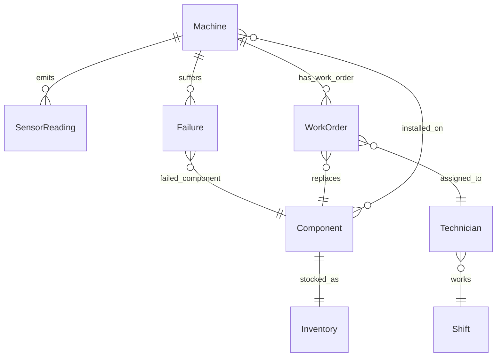

# Ontology

Forged is a small plant, described as objects and the links between them. The code is `ontology/model.py`. The tables are `db/schema.sql`. A pipeline build and the bundled sample plant both refuse to finish if an object that should have rows is empty, or if a link points at something that is not there.

This is the same idea as an ontology in an operational system: a Machine is a thing you can point at, a Sensor reading is a thing that machine emitted, and a work order is a decision someone made about it. It is not a Foundry application. There is no live writeback to a customer CMMS.

Component and Inventory share the `parts` table. This dataset has one SKU per component, so one row is both the component type and the bin. A real storeroom would split those. The `inventory` view is the bin.

Shift hours, technician names, skills, stock, line, and production impact are simulated. Sensor readings, failures, and machine model and age are the Azure sample on a full build. On the bundled 12-machine plant, the scores are authored so the app can open without that download. The object types are the same either way.

## Objects

| Object | Backing | Primary key | What it is |
| --- | --- | --- | --- |
| Machine | `machines` | `machine_id` | The asset. Model and age are from the file. Line and production impact are simulated. |
| Component | `parts` | `component` | comp1–comp4. The file never says what they physically are. One SKU each. |
| SensorReading | `sensor_readings` | `machine_id`, `ts` | One hour of voltage, rotation, pressure, and vibration. |
| Failure | `failures` | `failure_id` | A component broke. This is a label. It is not a model feature. |
| WorkOrder | `work_orders` | `work_order_id` | Opened from the queue, closed when a repair is logged. May be empty after a fresh build. |
| Technician | `technicians` | `technician_id` | Simulated name, skill, and shift. |
| Shift | `shifts` | `shift_id` | Day 06:00–14:00, swing 14:00–22:00, night otherwise. Simulated hours. |
| Inventory | `inventory` | `inventory_id` | On hand, reorder point, lead time. A view over `parts`. |

The parts factor uses Inventory. It is **1.5** when `on_hand` is 0 or below `reorder_point`, otherwise **1.0**. That rule is in `models/priority.py`, not in the table.

## Links

| Link | From | To | Cardinality | How it is stored |
| --- | --- | --- | --- | --- |
| emits | Machine | SensorReading | one to many | `sensor_readings.machine_id` |
| suffers | Machine | Failure | one to many | `failures.machine_id` |
| failed_component | Failure | Component | many to one | `failures.component` matches `parts.component` |
| has_work_order | Machine | WorkOrder | one to many | `work_orders.machine_id` |
| replaces | WorkOrder | Component | many to one | `work_orders.component` |
| assigned_to | WorkOrder | Technician | many to one | `work_orders.technician_id` |
| works | Technician | Shift | many to one | `technicians.shift` references `shifts.shift_id` |
| stocked_as | Component | Inventory | one to one | same row, exposed as the `inventory` view |
| installed_on | Component | Machine | many to many | a `maintenance_events` row is a replacement of that component on that machine |

`installed_on` is not a separate object. A maintenance event is the evidence that a component was on a machine and was replaced. Historical rows from the Azure file are stored as scheduled, because the file does not say otherwise. A repair logged in the app is unscheduled and names the technician.

The skill on a technician is the other half of that link. comp1 is mechanical, comp2 is hydraulics, comp3 is electrical, comp4 is general. That map is simulated. It lives next to the Shift and Component definitions in `ontology/model.py`, and the roster seed reads it from there.

## What the pipeline checks

`assert_warehouse_matches_ontology` runs at the end of `pipeline/run.py` and after the sample plant is built.

- Machine, Component, SensorReading, Failure, Technician, Shift, and Inventory have at least one row.
- WorkOrder may be empty. A new plant has not opened a job yet.
- Every link query above returns no dangling rows. A failure whose component is not a known part, or a technician whose shift is not a known shift, fails the build.

The two benchmark tables, `bench_ai4i` and `bench_cmapss_fd001`, are not objects in this plant. They are other datasets, loaded beside it so the modeling work is queryable. They do not get machine ids.

## What a real supplier would replace

Keep the object types. Replace the rows.

- Sensor readings come from their historian, aggregated to the grain you decide to model. The 24-hour features assume hourly data only because the Azure file is hourly.
- Failures and work orders come from their CMMS. The failure is still a label, not a feature.
- Inventory comes from their storeroom. Delete the four seeded bins. If they have more than one SKU per component, split Component from Inventory instead of sharing `parts`.
- Technicians and shifts come from their roster. Delete the six fictional names.
- Production impact comes from which machine holds which order. Delete the seeded 1–5 numbers.

The priority formula and the cost rates stay a starting point until the lead replaces them. The C-MAPSS and AI4I models stay in the repo as proof. They do not score the shop's machines.
