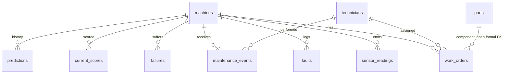

# Warehouse schema

The plant the dashboard runs on is one ontology. Two other public datasets are loaded beside it so the modeling work is queryable, and they are not forced into the plant tables. They describe different assets.

DuckDB executes `db/schema.sql`. Foreign keys are declared. The loader also checks them in `pipeline/validate.py`, which is what actually fails a bad file. `fix_first` is the ranked queue. `sensor_readings_live`, `faults_live`, `failures_live`, and `maintenance_live` hide anything after the plant clock.

## Plant tables

| Table | Key columns | Where it comes from |
| --- | --- | --- |
| `machines` | `machine_id` PK, `model`, `age_years`, `line`, `production_impact` (1–5) | Azure `PdM_machines.csv`, plus simulated line and impact |
| `sensor_readings` | `machine_id`, `ts`, `volt`, `rotate`, `pressure`, `vibration` | Azure `PdM_telemetry.csv` |
| `faults` | `fault_id`, `machine_id`, `ts`, `error_code` | Azure `PdM_errors.csv` |
| `failures` | `failure_id`, `machine_id`, `ts`, `component` | Azure `PdM_failures.csv` |
| `maintenance_events` | `event_id`, `machine_id`, `ts`, `component`, `type`, `technician_id` | Azure `PdM_maint.csv`, plus repairs the dashboard logs |
| `parts` | `part_id`, `component`, `on_hand`, `reorder_point`, `lead_time_days`, `simulated` | Seeded. SIMULATED |
| `technicians` | `technician_id`, `name`, `skill`, `shift`, `simulated` | Seeded. SIMULATED |
| `work_orders` | `work_order_id`, `machine_id`, `component`, `status`, `priority_score`, `opened_ts`, `closed_ts`, `technician_id`, `reason` | Created in the dashboard |
| `current_scores` | one row per machine at the plant clock | Model output |
| `predictions` | one row per machine per test-period morning | Model output, used for the trend and the backtest |
| `plant_clock` | `as_of` | The replay cursor |

`current_scores` and `predictions` carry `p_fail_24h`, `predicted_component`, `parts_factor`, `priority_score`, `queue_score`, `band`, and `top_reason`. `queue_score` equals `priority_score` unless a component was replaced in the last 24 hours, in which case it is 15% of the formula. The backtest ranks by `priority_score` only.

## Column mapping

### PdM_telemetry.csv → `sensor_readings`

| Source column | Warehouse column | Decision |
| --- | --- | --- |
| `datetime` | `ts` | Kept. Parsed as a timestamp. |
| `machineID` | `machine_id` | Kept. |
| `volt`, `rotate`, `pressure`, `vibration` | same names | Kept. The model does not use the single hour. It uses the trailing 24-hour mean and standard deviation. |

### PdM_errors.csv → `faults`

| Source column | Warehouse column | Decision |
| --- | --- | --- |
| `datetime` | `ts` | Kept. |
| `machineID` | `machine_id` | Kept. |
| `errorID` | `error_code` | Kept. Values are `error1`–`error5`. |

### PdM_failures.csv → `failures`

| Source column | Warehouse column | Decision |
| --- | --- | --- |
| `datetime` | `ts` | Kept. Used as a label, never as a feature. |
| `machineID` | `machine_id` | Kept. |
| `failure` | `component` | Kept. Values are `comp1`–`comp4`. |

### PdM_maint.csv → `maintenance_events`

| Source column | Warehouse column | Decision |
| --- | --- | --- |
| `datetime` | `ts` | Kept. The file starts in June 2014, before telemetry. |
| `machineID` | `machine_id` | Kept. |
| `comp` | `component` | Kept. |
| — | `type` | Added. Source rows are stored as `scheduled`. The file does not say scheduled versus breakdown. Repairs logged in the app are `unscheduled`. |
| — | `technician_id` | Added. Null on source rows. Filled only when the app closes a work order. |
| — | `event_id` | Surrogate key. |

### PdM_machines.csv → `machines`

| Source column | Warehouse column | Decision |
| --- | --- | --- |
| `machineID` | `machine_id` | Kept. |
| `model` | `model` | Kept. `model1`–`model4`. |
| `age` | `age_years` | Kept. |
| — | `line` | SIMULATED. Rotated across Machining, Assembly, Test, Finish. |
| — | `production_impact` | SIMULATED. Integers 1–5 from a seeded generator (seed 42). |

## What is not a plant entity

### AI4I 2020 → `bench_ai4i`

All 14 source columns are kept, renamed to snake_case: `udi`, `product_id`, `type`, `air_temp_k`, `process_temp_k`, `rpm`, `torque_nm`, `tool_wear_min`, `machine_failure`, `twf`, `hdf`, `pwf`, `osf`, `rnf`.

Dropped from the **model**, not from the table: `udi` and `product_id` are identifiers. `rnf` is kept in the table and is not a prediction target, because the dataset defines it as a random failure. `type` value `L` is the reference level and is not a dummy column.

### C-MAPSS FD001 → `bench_cmapss_fd001` and `bench_cmapss_rul`

| Source | Warehouse | Decision |
| --- | --- | --- |
| Column 1 | `unit` | Kept. |
| Column 2 | `cycle` | Kept. Not used as a model feature. On a run-to-failure training set, cycle number is a backdoor to remaining life, and it does not mean the same thing on the truncated test engines. |
| Columns 3–5 | `op1`, `op2`, `op3` | Kept. `op3` is constant on FD001 and is dropped from the model. |
| Columns 6–26 | `s1`–`s21` | Kept. Sensors with zero variance on the training engines are dropped from the model. The training run records which ones. |
| `RUL_FD001.txt` | `bench_cmapss_rul.rul` | One official remaining-life value per test engine, in unit order. |
| — | `split` | Added. `train` or `test`. |

FD002, FD003, and FD004 ship inside the NASA zip and stay on disk under `data/raw/cmapss/`. They are not loaded. The model in this project is FD001 only, which is the single-condition, single-fault subset.

## Checks the loader enforces

- No null keys.
- `machine_id` on every fact table exists in `machines`.
- No duplicate `(machine_id, ts)` in telemetry, and no duplicate machines.
- Telemetry timestamps fall in 2015 through 2016-01-01. Maintenance may start on 2014-06-01, because the source file does.
- Telemetry is an hourly grid. A 24-row rolling window is a 24-hour window only because that check passed.
